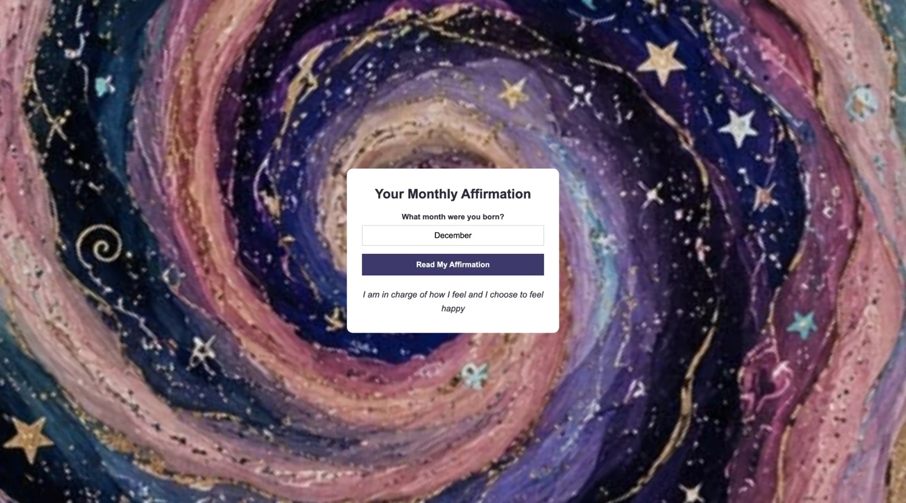

# Monthly Affirmation ✨

A page where you type the month you were born and get an affirmation to match.

## Description

This is a project I built to practice `if` and `else if` statements and working with the page using JavaScript. You type your birth month, click the button, and the page shows a short affirmation written for that month. There are 12 affirmations, one for each month. If the month isn't recognized, it gently tells you what to try. It uses plain HTML, CSS, and JavaScript, so there is no server to run.

## Screenshot

## Features

- Type your birth month to get that month's affirmation
- 12 different affirmations, one for each month
- Capital letters and extra spaces don't matter, so "december" and " December " both work
- Shows a hint if the month isn't recognized: "Try typing a full month name, like December."
- Colorful swirling night sky background

## Tech Used

- HTML
- CSS
- JavaScript

## How to Use

This app doesn't need a server or an API key.

1. Download or clone the project.
2. Open `index.html` in your browser (or use the Live Server extension in VS Code).
3. Type your birth month, spelled out in full (like "December", not "Dec").
4. Click **Read My Affirmation**.

## How It Works

1. When you click the button, `main.js` reads what you typed.
2. It trims off extra spaces and changes it to lowercase, so capital letters don't matter.
3. It checks the month against a list of 12 `if` / `else if` statements. Each one holds that month's affirmation.
4. If none of them match, it uses the hint message instead.
5. It shows the result under the button.

## What I Learned

- How to read what someone types into an input
- How to clean up text with `.toLowerCase()`
- How to use a chain of `if` / `else if` / `else` statements to pick a message
- How to show text on the page with `innerText`
- How to center a card on a full-page background image with CSS

VIEW APP HERE: https://horoscope-qtgh.onrender.com
## Author

Maya Rose 🌹
